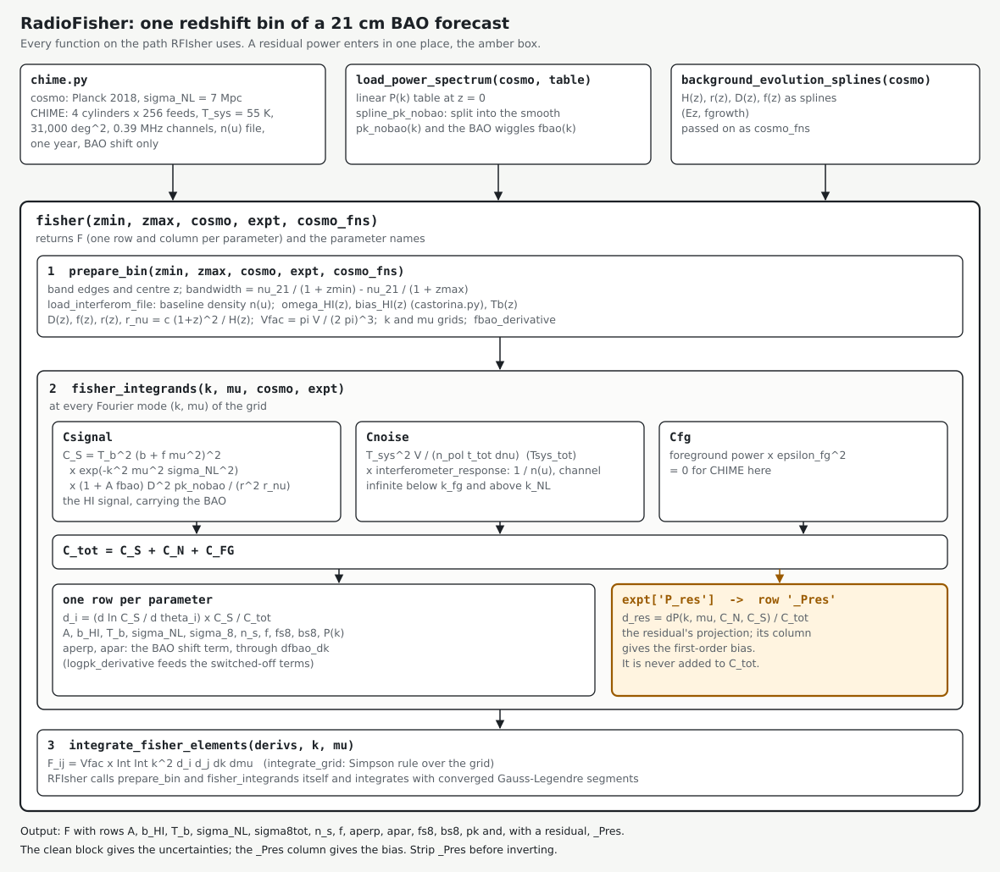

# RadioFisher (CHIME forecast path)

A Fisher forecast of the baryon acoustic oscillation (BAO) dilations from a 21 cm
intensity-mapping survey with a cylinder interferometer. This is
RadioFisher (Bull, Ferreira, Patel & Santos 2015, ApJ 803, 21,
[arXiv:1405.1452](https://arxiv.org/abs/1405.1452)) cut down to the one path the CHIME Overview forecast uses (CHIME Collaboration 2022,
ApJS 261, 29, Appendix A), with one hook for a power the model does not include.
[RFIsher](https://github.com/WVURAIL/RFIsher) uses that hook to find how much residual
DTV power each 6 MHz channel can tolerate.



## What it computes

For one redshift bin, `fisher()` returns the Fisher matrix of twelve parameters:
the BAO amplitude `A`, the HI bias `b_HI`, the brightness temperature `Tb`, the damping
`sigma_NL`, `sigma8tot`, `n_s`, the growth rate `f`, the two dilations `aperp` and
`apar`, `fs8`, `bs8` and the power amplitude `pk`. Each element is

    F_ij = Vfac * Int Int k^2 d_i d_j dk dmu,   d_i = (d ln C_S / d theta_i) * C_S / C_tot

with `C_tot = C_S + C_N + C_FG`: the HI signal (`Csignal`), the thermal noise of the
cylinder array (`Cnoise`) and the foreground residual (`Cfg`, zero for CHIME here).

## The residual hook

If `expt['P_res']` is set, `fisher_integrands` adds one more row, `_Pres`, equal to
`dP / C_tot`. The residual `dP` is either a multiple of the noise power or a callable
`dP(k, mu, C_N, C_S)`. It never enters `C_tot`, so the rest of the matrix is the clean
forecast. The `_Pres` column gives the first-order bias: with `C` the inverse of the
fitted block and `B` the `_Pres` column, the bias of the fitted parameters is `C B`.
Strip `_Pres` before inverting.

## Use

```python
import copy
import radiofisher as rf
from radiofisher.units import HRS_MHZ

cosmo = rf.load_power_spectrum(copy.deepcopy(rf.chime.cosmo), "pk_planck2018.dat")
fns = rf.background_evolution_splines(cosmo)
expt = dict(rf.chime.CHIME, ttot=8760 * HRS_MHZ, P_res=0.01)
F, names = rf.fisher(1.20, 1.25, cosmo, expt, fns)
```

The P(k) table is a linear matter power spectrum at z = 0 (columns k in Mpc^-1 and
P in Mpc^3). RFIsher ships the Planck 2018 table and checks it against the cosmology.

`prepare_bin()` returns the set-up `fisher()` integrates over, so a caller can evaluate
`fisher_integrands()` at its own quadrature nodes. RFIsher does this: RadioFisher's
Simpson grid is not accurate enough for the bias row.

## Files

| File | Contents |
|---|---|
| `radiofisher/baofisher.py` | the forecast: inputs, background, signal and noise, integrands, `fisher()` |
| `radiofisher/chime.py` | CHIME and the Planck 2018 cosmology, as in the CHIME Overview |
| `radiofisher/castorina.py` | the HI bias fit of Castorina & Villaescusa-Navarro (2017) |
| `radiofisher/data/nx_CHIME_800.dat` | CHIME's as-built baseline density n(u) |
| `docs/diagram.py` | draws the call graph above |

## What was removed

Everything off this path: the other telescopes and survey modes, galaxy surveys,
modified gravity, neutrino and non-Gaussianity parameters, CAMB execution, the
redshift-binning and plotting helpers, and the CHIME Overview's multi-bin combination.
Commit 6348429 is the last version with all of it. The tests check that the cut code
reproduces that version's Fisher matrices; they agree exactly.

## Tests

```bash
python -m pip install -e ".[test]"
python -m pytest -q
```

## Credits

Philip Bull and Pedro G. Ferreira wrote RadioFisher (2013 to 2014). Simon Foreman wrote the
CHIME configuration for the CHIME Overview. If you use this code, cite Bull, Ferreira,
Patel & Santos (2015), [doi:10.1088/0004-637X/803/1/21](https://doi.org/10.1088/0004-637X/803/1/21).
Academic Free License v3.0; see `LICENSE`.
